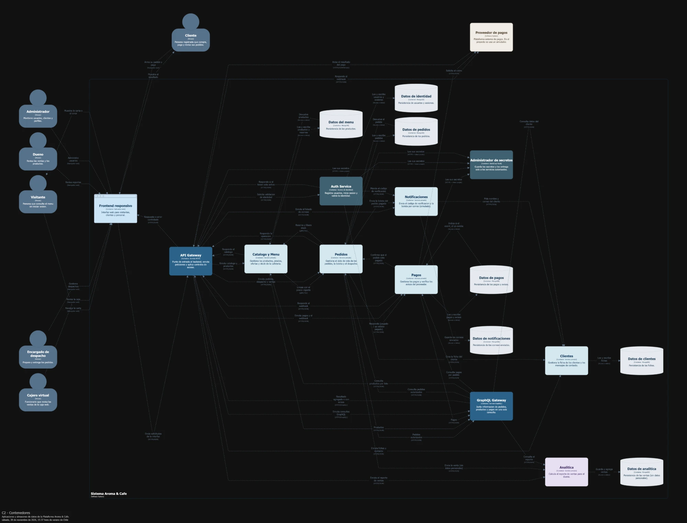
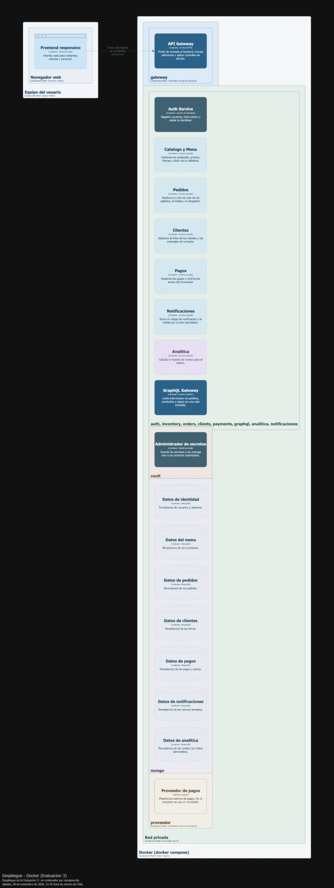
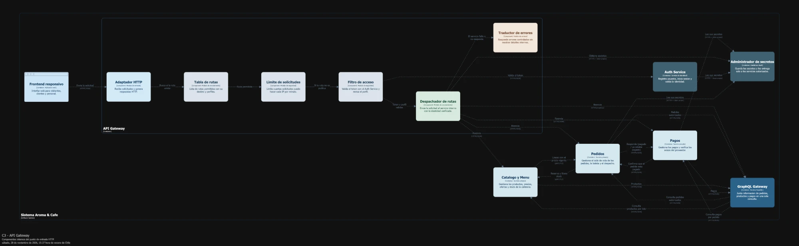
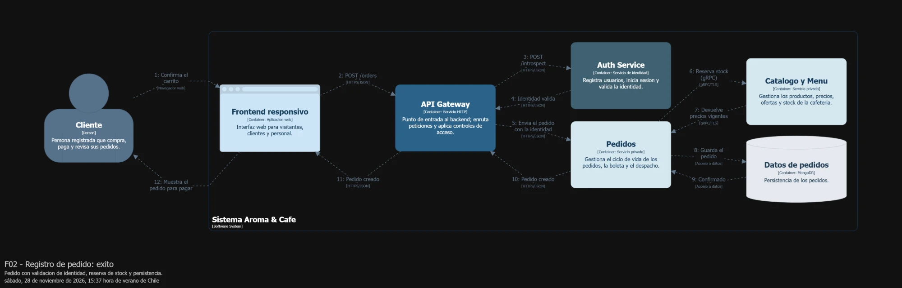
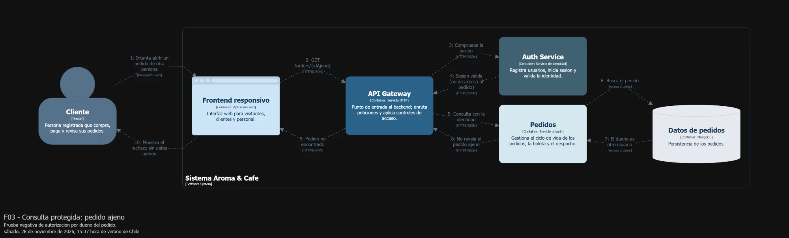
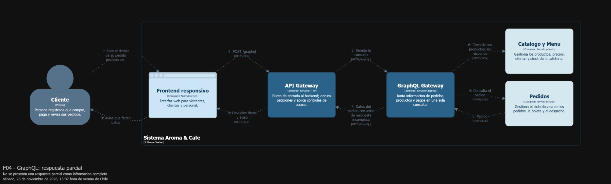
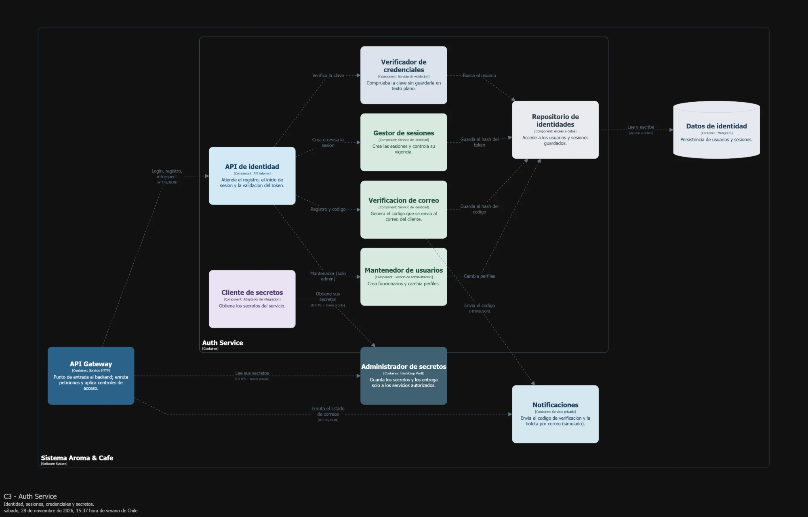
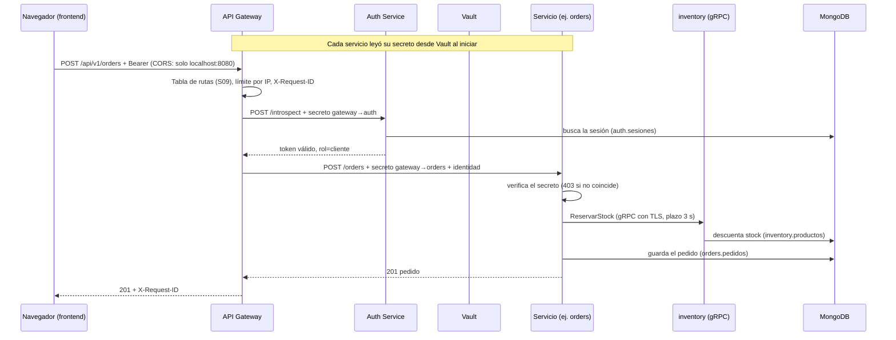

# 10. Diagramas

El modelo C4 está en `Backend/docs/arquitectura/AromaCafe.dsl` (Structurizr DSL). En esta unidad se agregó la vista de despliegue
**DEP_Docker**, que muestra dónde corre cada componente; las llamadas entre servicios están en las vistas C2 y dinámicas. Las demás vistas
vienen de la Unidad 2 y siguen siendo válidas.

## Vistas del modelo

| Archivo | Vista del DSL | Qué muestra |
|---|---|---|
| `diagramas/01-contenedores.png` | `C2_Contenedores` | Frontend, gateway, Auth, Vault, servicios privados, GraphQL y bases |
| `diagramas/02-despliegue-docker.png` | `DEP_Docker` | Contenedores, redes pública y privada, puertos publicados |
| `diagramas/03-gateway-seguridad.png` | `C3_API_Gateway` | Límite de solicitudes, tabla de rutas, validación con Auth y secretos |
| `diagramas/04-auth.png` | `C3_Auth_Service` | Sesiones, credenciales y verificación del secreto |
| `diagramas/05-pedido.png` | `D_F02_Exito` | Recorrido de un pedido: gateway → Auth → orders → inventory (gRPC) → MongoDB |
| `diagramas/06-pedido-ajeno.png` | `D_F03_Ajeno` | Rechazo de un pedido ajeno |
| `diagramas/07-graphql-parcial.png` | `D_F04_GraphQL_Parcial` | GraphQL con una dependencia caída: respuesta parcial con aviso |

## Diagramas

### C2 – Contenedores

### Despliegue en Docker: redes, contenedores y la única entrada desde el navegador

### C3 – API Gateway: entrada, límite de solicitudes, tabla de rutas, filtro de acceso con Auth y secretos

### Pedido: registro exitoso (gateway → Auth → orders → inventory por gRPC → MongoDB)

### Pedido ajeno: rechazo sin revelar datos

### GraphQL con una dependencia caída: respuesta parcial con aviso

### C3 – Auth Service: sesiones, credenciales y secretos

## Recorrido de una solicitud con sesión (vista resumida)

