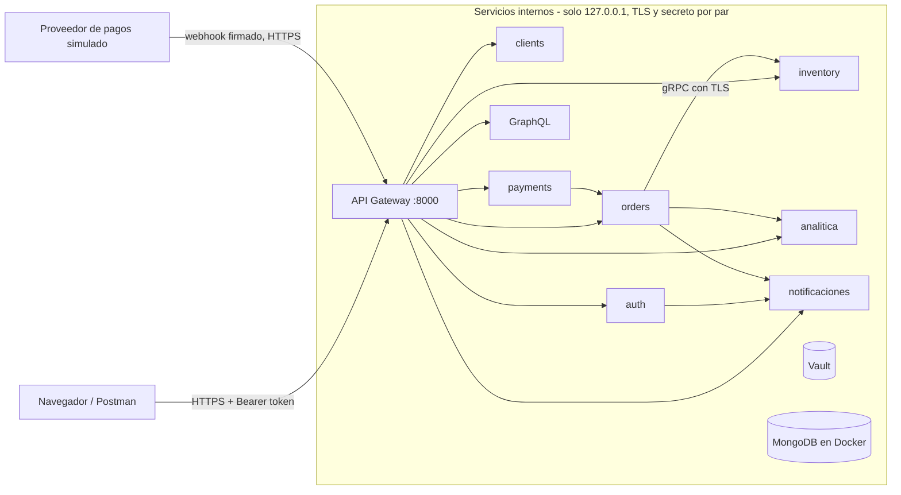
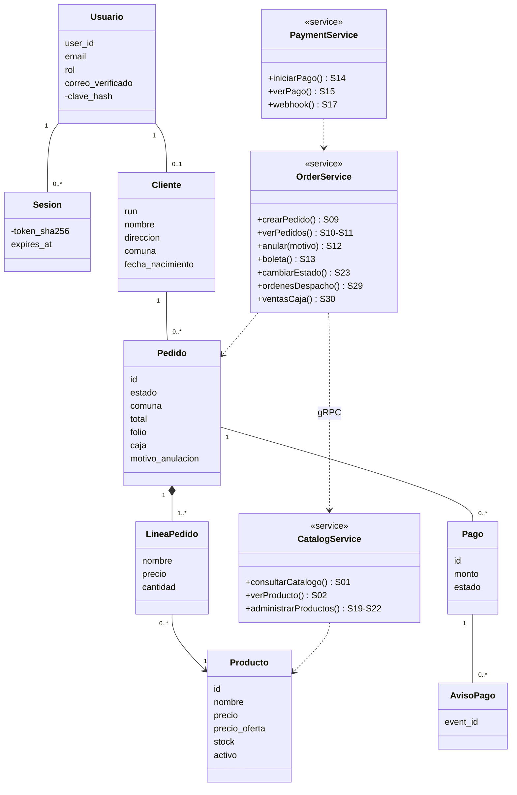
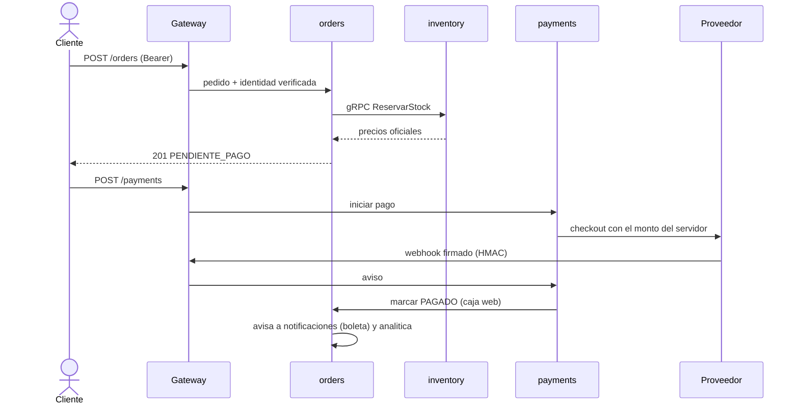
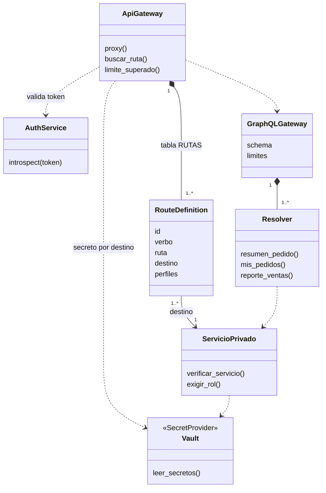

# Aroma & Café – Backend seguro (Evaluación Unidad 2)

| | |
|---|---|
| Caso | N° 4 – Cafetería "Aroma & Café" (café de especialidad y repostería), del listado *Innovación.pdf*, basado en el Caso 19 "Sistema de Ventas On-line Fukusuke Sushi-Delivery" |
| Integrantes | Ian Arroyo · Alejandro Martínez (NRC 8479) |
| Versión del frontend | Carpeta `Fronted/` del repositorio `Desarrollo-Web-Movil` (commit `40cc24a`, "Mejora Frontend") |
| Entrega | 09-11-2026 |

## Índice

1. [Introducción](#introducción)
2. [Cómo ejecutar el proyecto](#cómo-ejecutar-el-proyecto)
3. [Arquitectura (mapa de sistemas y despliegue)](#arquitectura-mapa-de-sistemas-y-despliegue)
4. [Módulo 1 – Servicios derivados del frontend](#módulo-1--servicios-derivados-del-frontend)
5. [Módulo 2 – Clases y cardinalidades del dominio](#módulo-2--clases-y-cardinalidades-del-dominio)
6. [Módulo 3 – Sistemas e integraciones](#módulo-3--sistemas-e-integraciones)
7. [Módulo 4 – Stakeholders y permisos HTTP](#módulo-4--stakeholders-y-permisos-http)
8. [Módulo 5 – API Gateway](#módulo-5--api-gateway)
9. [Módulo 6 – Rutas y secretos de integración](#módulo-6--rutas-y-secretos-de-integración)
10. [Módulo 7 – Datos sensibles y secretos del cliente](#módulo-7--datos-sensibles-y-secretos-del-cliente)
11. [Módulo 8 – Separación privada y agregación GraphQL](#módulo-8--separación-privada-y-agregación-graphql)
12. [Módulo 9 – Analítica y gRPC](#módulo-9--analítica-y-grpc)
13. [Módulo 10 – Backend completo e integración verificable](#módulo-10--backend-completo-e-integración-verificable)
14. [Brechas y pendientes](#brechas-y-pendientes)

## Introducción

En esta evaluación construimos el backend de Aroma & Café, la cafetería que elegimos para el frontend de la unidad anterior. Como el caso viene del Caso 19 (Fukusuke Sushi), mantuvimos sus requisitos principales y los adaptamos a una cafetería:

- registro de clientes con validación de correo;
- pedidos en línea con pago externo;
- boleta digital;
- despacho a domicilio;
- reportes para el dueño.

Para la arquitectura partimos del ejemplo `apigateway` que vimos en clases (Semana 9): un API Gateway, un Auth Service y backends que validan un secreto con `verify_gateway`. Desde ahí lo fuimos ampliando con lo que pide la pauta. También reutilizamos lo de otras semanas: el CRUD con FastAPI y MongoDB de la Semana 6, la idea de GraphQL de la Semana 5 (aquí hecha con Strawberry, en Python) y el uso de `ThreadPoolExecutor` de la Semana 11.

Esta entrega es **solo el backend**. La conexión con el frontend la dejamos para la siguiente entrega, así que aquí no hay script de integración ni pruebas de interfaz con Playwright. Lo explicamos mejor en [Brechas y pendientes](#brechas-y-pendientes).

**Tecnologías:** Python + FastAPI, MongoDB 7 (pymongo), HashiCorp Vault, GraphQL (Strawberry), gRPC, argon2id, TLS con certificados propios, Docker (solo para MongoDB), Postman + Newman (Node.js solo para ejecutar Newman).

### Requisitos del Caso 19 que tomamos

| RF | Requisito | Servicios |
|---|---|---|
| RF1 | Armar un pedido con los productos disponibles del menú | S01, S09 |
| RF2 | El pedido se prepara solo cuando el pago está confirmado | S17, S23 |
| RF3 | Anular una compra indicando el motivo | S12 |
| RF4 | Vender solo a clientes registrados; las ventas web van a la caja de un cajero virtual | S09, S30 |
| RF5 | Registro de clientes con run, nombre, dirección, comuna, provincia, región, fecha de nacimiento, sexo, correo y teléfono | S03, S07 |
| RF6 | El administrador también puede registrar clientes en el local | S31 |
| RF7 | Consultar y actualizar la disponibilidad de los productos | S19–S22 |
| RF8 | Boleta digital por cada venta, enviada al correo del cliente | S13 + notificaciones |
| RF9 | Reporte de ventas por período para el dueño | S26 |
| RF10 | Mantenedores de productos, usuarios y clientes | S19–S22, S31–S35 |
| RF11 | Validar que el correo exista mediante una API de mensajería | S28 + notificaciones |
| RF12 | Autenticación y acceso según el perfil que asigna el administrador | S04, S33–S35 |
| RF13 | Órdenes de despacho en el orden en que van llegando | S29 |
| Solución del caso | Despacho gratuito dentro de 3 km, pago por plataforma externa, ofertas en el sitio | S09, S14–S17, S01 |

---

## Cómo ejecutar el proyecto

Los servicios y Vault corren directamente en el computador. Solo MongoDB corre en Docker. Se necesita:

| Programa | Para qué | Dónde se consigue |
|---|---|---|
| Python 3.10 o superior | Los 10 servicios, el script de inicio y las pruebas | python.org |
| Docker Desktop | Solo para MongoDB (`docker-compose.yml`) | docker.com |
| HashiCorp Vault | El administrador de secretos | developer.hashicorp.com/vault/install |
| Node.js | Solo para correr Newman (opcional) | nodejs.org |

No hace falta configurar MongoDB ni Vault a mano: `iniciar.py` los inicia y los prepara. Docker Desktop tiene que estar abierto (que diga *Engine running*). Si `vault` no está en el PATH, se puede indicar su ruta con la variable `VAULT_BIN`. En Windows se busca solo en `C:\Program Files\HashiCorp\Vault\`.

**1. Instalar las dependencias de Python.** Se recomienda un entorno virtual. En Windows el segundo comando es `.venv\Scripts\activate`.

```bash
python -m venv .venv
```

```bash
source .venv/bin/activate
```

```bash
pip install -r requirements.txt
```

**2. Configuración.** Copiar `.env.example` como `.env` y cambiar todos los valores. `SEED_PASSWORD` es la clave de los usuarios de prueba y debe tener al menos 8 caracteres. El `.env` no se sube al repositorio. En PowerShell el comando es `Copy-Item .env.example .env`.

```bash
cp .env.example .env
```

**3. Iniciar.** La primera vez se demora un poco más, porque Docker descarga la imagen de MongoDB. Cuando aparece `Backend listo`, el sistema está arriba.

```bash
python iniciar.py
```

Lo que hace `iniciar.py`:
1. genera los certificados TLS en `certs/` si no existen: una CA local y un certificado para `127.0.0.1` y `localhost`;
2. inicia MongoDB en Docker (publicado solo en `127.0.0.1:27018`) y Vault en modo desarrollo con TLS (`127.0.0.1:8200`);
3. genera secretos aleatorios, uno por cada par de servicios, y los guarda en Vault;
4. crea una política y un token de Vault por servicio, para que cada uno solo pueda leer su propio secreto;
5. crea un usuario de MongoDB por servicio, con permiso solo sobre su base;
6. inicia los 10 servicios con HTTPS, cada uno en su puerto de `127.0.0.1` (el gateway en el 8000), y los vigila: si uno se cae, lo vuelve a levantar.

Cada servicio escribe su log en `logs/`. Los tokens de Vault quedan en `datos/` y los certificados en `certs/`. Ninguna de esas carpetas se sube al repositorio.

**Abrirlo en el navegador o en Postman.** Todo va por HTTPS con nuestra propia CA, así que hay que confiar en `certs/ca.crt` una vez:
- **Windows:** doble clic en `certs\ca.crt` → *Instalar certificado* → *Usuario actual* → almacén *Entidades de certificación raíz de confianza*. Después https://127.0.0.1:8000/api/v1/products muestra la carta en JSON.
- **Postman:** *Settings → Certificates → CA certificates* y elegir `certs/ca.crt`.
- **Desde la terminal:** `curl --cacert certs/ca.crt https://127.0.0.1:8000/api/v1/products`.

**Usuarios de prueba.** Creamos un usuario ficticio por cada perfil del caso. Todos usan la clave de `SEED_PASSWORD`.

| Correo | Perfil |
|---|---|
| `admin@aromaycafe.test` | admin (administrador) |
| `dueno@aromaycafe.test` | dueno |
| `cajero@aromaycafe.test` | cajero (cajero virtual) |
| `despacho@aromaycafe.test` | despacho (encargado de despacho) |
| `ana@aromaycafe.test` | cliente |
| `pedro@aromaycafe.test` | cliente |

**Detener:** `Ctrl+C` en la terminal donde corre `iniciar.py`. Se detienen los servicios y Vault, y también el contenedor de MongoDB. Los datos se conservan en el volumen de Docker.

**Empezar de cero**, borrando la base de datos y los tokens:

```bash
python iniciar.py --limpiar
```

Vault corre en modo desarrollo y guarda los secretos en memoria, así que cada vez que se inicia se generan secretos nuevos. Las claves de MongoDB se actualizan para que calcen con los nuevos secretos.

**Pruebas.** Son scripts de Python que se corren en otra terminal mientras `iniciar.py` sigue abierto. Cada uno imprime `[OK]` o `[FALLA]` por prueba y guarda el resultado en `docs/evidencias/`. En PowerShell la clave se pasa con `$env:TEST_PASSWORD="..."` antes del comando.

| Script | Qué prueba |
|---|---|
| `pruebas/prueba_seguridad.py` | Los casos de validación del Módulo 7, permisos, GraphQL, TLS y aislamiento de Vault y MongoDB |
| `pruebas/prueba_flujos.py` | Los flujos del Caso 19: pedidos, pagos, boleta, despacho, registro, reportes, caja y mantenedores |
| `pruebas/prueba_fallos.py` | inventory y auth caídos con recuperación, y compras simultáneas sobre poco stock |
| `pruebas/prueba_carga.py` | La prueba de carga del Módulo 9 |

```bash
TEST_PASSWORD=<tu SEED_PASSWORD> python pruebas/prueba_seguridad.py
```

```bash
TEST_PASSWORD=<tu SEED_PASSWORD> python pruebas/prueba_flujos.py
```

```bash
TEST_PASSWORD=<tu SEED_PASSWORD> python pruebas/prueba_fallos.py
```

El gateway acepta 120 solicitudes por minuto por IP (10 en login y registro). Como las pruebas son rápidas, a veces llegan a ese límite; cuando reciben un `429`, esperan un minuto y reintentan solas. Por eso a veces se demoran un poco más.

Colección de Postman con Newman:

```bash
cd postman && npm install
```

```bash
npx newman run AromaCafe.postman_collection.json -e AromaCafe.postman_environment.json --env-var password=<tu SEED_PASSWORD> --ssl-extra-ca-certs ../certs/ca.crt
```

Prueba de carga. Hay que subir el límite del gateway solo mientras dura la prueba: se detiene `iniciar.py` y se inicia de nuevo con la variable `LIMITE_POR_MINUTO`. Al terminar se vuelve a iniciar sin ella. En PowerShell: `$env:LIMITE_POR_MINUTO="100000"; python iniciar.py`.

```bash
LIMITE_POR_MINUTO=100000 python iniciar.py
```

```bash
TEST_PASSWORD=<tu SEED_PASSWORD> python pruebas/prueba_carga.py
```

| Carpeta o archivo | Qué contiene |
|---|---|
| `iniciar.py` | Inicia y detiene todo: certificados, MongoDB (Docker), Vault, secretos, tokens, usuarios de Mongo y los 10 servicios |
| `docker-compose.yml` | Solo MongoDB, publicado en `127.0.0.1:27018` |
| `requirements.txt` | Dependencias de Python con versión fija |
| `backend/` | Un `main.py` por servicio, `comun.py` (Vault, `verificar_servicio`, llamadas entre servicios con TLS, conexión a Mongo y logs) y `proto/` (contrato gRPC) |
| `pruebas/` | Scripts de prueba (seguridad, flujos, fallos y carga) |
| `postman/` | Colección por perfil y entorno |
| `docs/arquitectura/AromaCafe.dsl` | Modelo C4 en Structurizr (contexto, contenedores, componentes, flujos y despliegue) |
| `docs/evidencias/` | Resultados de los scripts de prueba, de Newman y de la prueba de carga, y un ejemplo de logs con id de correlación |

---

## Arquitectura (mapa de sistemas y despliegue)



La entrada para el navegador y Postman es el **API Gateway** (`https://127.0.0.1:8000`). Todo corre en un solo computador y cada proceso escucha solo en `127.0.0.1`, así que desde otro equipo de la red no se puede entrar a ninguno. MongoDB corre en Docker, pero su puerto también se publica solo en `127.0.0.1`.

Todas las llamadas HTTP van cifradas con TLS: navegador → gateway, gateway → servicios, servicios entre sí y servicios → Vault. La llamada gRPC de orders a inventory también. Los servicios internos tienen sus propios puertos (8001 a 8009 y el 50051 de gRPC), pero rechazan cualquier llamada que no traiga el secreto de su par. No hay una red privada aparte, así que la separación depende de esos secretos (ver [Brechas](#brechas-y-pendientes)).

El modelo C4 completo está en `docs/arquitectura/AromaCafe.dsl`. Lo armamos siguiendo el ejemplo "Plataforma Comercial" que nos pasó el profe, pero con nuestros servicios. Trae:
- C1 y C2;
- C3 del API Gateway, del GraphQL gateway, del Auth Service y de orders;
- los flujos F01 a F04 (éxito, fallo y recuperación, pedido ajeno, sesión expirada, GraphQL parcial y límite);
- el despliegue local (lo que levanta `iniciar.py`, con MongoDB en Docker).

Se puede abrir en https://structurizr.com/dsl, donde se ven sus 20 vistas. Todos los diagramas son editables: los de este informe están en Mermaid (texto dentro del README) y el modelo C4 en el `.dsl`.

Las flechas de este mapa son llamadas de red, no relaciones UML. Para que no quedara muy cargado no dibujamos todas:
- el GraphQL gateway consulta a orders, inventory, payments, clients y analitica;
- cada servicio lee su propio secreto en Vault;
- los servicios que guardan datos tienen su propia base en MongoDB.

---

## Módulo 1 – Servicios derivados del frontend

### Pantallas y brechas

Recorrimos las pantallas de nuestro frontend. Como es responsive, el escritorio y el móvil usan las mismas pantallas, así que no fue necesario crear servicios distintos para cada uno.

| ID | Pantalla | Acciones | Servicio |
|---|---|---|---|
| P01 | Inicio (`index.php`) | Destacados, buscador, agregar al carrito | S01 |
| P02 | Carta (`catalogo.php`) | Listado, filtros por categoría, búsqueda | S01, S02 |
| P03 | Pedido (`carrito.php`) | Cantidades, total, "Pagar pedido" | S09, S14, S15 |
| P04 | Contacto (`Contacto.php`) | Formulario con email, nombre, teléfono, motivo y mensaje | S08 |
| P05 | Locales (`Locales.php`) | Información de los locales | Ninguno (es contenido fijo y no vimos necesario un servicio) |

Al compararlo con el Caso 19 nos dimos cuenta de que varias funciones no tienen pantalla todavía. Los botones de "Iniciar sesión" y "Registrarse", por ejemplo, apuntan a `#`. Igual implementamos los servicios, y las pantallas las agregaremos al integrar:

| Función sin pantalla | Servicios |
|---|---|
| Login, registro y verificación de correo | S03–S05, S28 |
| Mis pedidos, anulación y boleta | S10–S13, S18 |
| Ficha del cliente | S06, S07 |
| Ofertas (antes había un link a `Ofertas.php`, pero esa página no existía) | S01 con `?ofertas=true` |
| Panel de despacho, del cajero, del dueño y del administrador | S23, S24, S29, S30, S19–S22, S26, S25, S27, S31–S35 |

Otra cosa que notamos: el carrito se guarda en el navegador (`localStorage`). Para armar el pedido sirve, pero el precio y el total que se ven en pantalla no los usamos para nada. El servidor los vuelve a calcular.

### Convenciones

- **Sesión:** el login entrega un token que se envía en la cabecera `Authorization: Bearer <token>`, como en el ejemplo de clase. Dura 15 minutos.
- **Perfiles:** `cliente`, `cajero`, `despacho`, `dueno` y `admin`, que salen de los actores del Caso 19.
- **Errores:** siempre responden `{"detail": "..."}`. Los códigos que usamos son:

| Código | Significado |
|---|---|
| 400 | Dato inválido |
| 401 | Sin sesión |
| 403 | Sin permiso, o correo sin verificar |
| 404 | No existe, o no es tuyo |
| 409 | Conflicto de estado o de stock |
| 413 | Cuerpo de más de 64 KB |
| 422 | Error de validación |
| 429 | Demasiadas solicitudes |
| 502 / 503 | Un servicio interno está caído (no se muestran detalles) |

- **Clasificación de datos:** **P** = público, **R** = restringido (dato personal o del negocio), **C** = credencial (nunca se devuelve).

### Catálogo de servicios

Todas las rutas empiezan con `/api/v1`.

| ID | RF · Pantalla | Propósito | Verbo y ruta | Entrada | Salida y errores | Datos | Acceso |
|---|---|---|---|---|---|---|---|
| S01 | RF1, RF7 · P01, P02, ofertas* | Ver la carta y ofertas | `GET /products?categoria=&q=&ofertas=` | Filtros opcionales | 200 lista (o `[]`), sin stock | P | Anónimo |
| S02 | RF1 · P02 | Ver un producto | `GET /products/{id}` | — | 200 / 404 | P | Anónimo |
| S03 | RF5, RF11 · registro* | Registro | `POST /auth/register` | email, nombre, password + datos RF5 | 201 (correo pendiente) / 409 / 422 | R, C | Anónimo |
| S04 | RF12 · login* | Login | `POST /auth/login` | email, password | 200 token / 401 / 403 sin verificar / 429 | C | Anónimo |
| S05 | RF12 · login* | Logout | `POST /auth/logout` | — | 200 | — | Con sesión |
| S06 | RF5 · ficha* | Mi ficha | `GET /clients/me` | — | 200 | R | Con sesión |
| S07 | RF5 · ficha* | Actualizar mi ficha | `PUT /clients/me` | Datos RF5 | 200 / 422 (RUN, teléfono o fecha) | R | Con sesión |
| S08 | — · P04 | Contacto | `POST /contact` | nombre, email, motivo, mensaje | 201 / 422 | R | Anónimo |
| S09 | RF1, RF4 · P03 | Crear pedido | `POST /orders` | items (id, cantidad), tipo de entrega, dirección y comuna | 201 / 409 sin stock / 422 fuera del radio / 502 si inventory no responde | R | cliente |
| S10 | RF2 · mis pedidos* | Mis pedidos | `GET /orders` | estado, limit, skip | 200 (cliente: solo los suyos) | R | Con sesión |
| S11 | RF2 · mis pedidos* | Ver pedido | `GET /orders/{id}` | — | 200 / 404 si es ajeno | R | Con sesión |
| S12 | RF3 · mis pedidos* | Anular | `POST /orders/{id}/cancel` | motivo | 200 / 409 pagado / 422 sin motivo / 404 | R | cliente, admin |
| S13 | RF8 · mis pedidos* | Boleta | `GET /orders/{id}/receipt` | — | 200 (con caja) / 409 sin pago | R | Con sesión |
| S14 | Pago externo · P03 | Iniciar pago | `POST /payments` | order_id | 201 monto y `url_pago` / 404 / 409 | R | cliente |
| S15 | Pago externo · P03 | Ver pago | `GET /payments/{id}` | — | 200 / 404 | R | Con sesión |
| S16 | Pago externo · P03 | Pago de prueba (sandbox) | `POST /payments/{id}/simular` | resultado, repetir_aviso | 202 | — | cliente |
| S17 | RF2 · (proveedor) | Aviso del proveedor | `POST /payments/webhook` | Aviso con firma `X-Firma` | 200 / 401 firma inválida / 400 | R | Proveedor |
| S18 | RF2 · mis pedidos* | Resumen agregado | `POST /graphql` | Consulta GraphQL | 200 (data/errors) / 422 | R | Con sesión |
| S19–S22 | RF7, RF10 · panel dueño* | Mantenedor de productos | `GET/POST/PUT/DELETE /admin/products[/{id}]` | Datos del producto y precio de oferta | 200 / 201 / 204 / 409 / 422 | P, R | dueno, admin |
| S23 | RF2, RF13 · panel despacho* | Avanzar estado del pedido | `PUT /admin/orders/{id}/status` | estado | 200 / 409 transición inválida | R | despacho, admin |
| S24 | RF13 · panel despacho* | Datos de entrega del cliente | `GET /admin/clients/{id}` | — | 200 (despacho: lo mínimo) | R | despacho, admin |
| S25 | — · panel admin* | Mensajes de contacto | `GET /admin/contact` | limit, skip | 200 | R | admin |
| S26 | RF9 · panel dueño* | Reporte de ventas | `GET /admin/reports/sales?desde=&hasta=` | Fechas | 200 | P (agregado) | dueno, admin |
| S27 | RF8, RF11 · panel admin* | Correos enviados | `GET /admin/notifications` | — | 200 (correo enmascarado, sin cuerpo) | R | admin |
| S28 | RF11 · registro* | Verificar correo | `POST /auth/verify-email` | email, código de 6 dígitos | 200 / 400 código inválido o vencido | C | Anónimo |
| S29 | RF13 · panel despacho* | Órdenes de despacho | `GET /admin/dispatch-orders` | — | 200 por orden de pago | R | despacho, admin |
| S30 | RF4 · panel cajero* | Ventas de la caja web | `GET /admin/sales` | limit | 200 | R | cajero, admin |
| S31 | RF6 · panel admin* | Registrar cliente en el local | `POST /admin/clients` | Igual que S03 | 201 / 409 / 422 | R, C | admin |
| S32 | RF6, RF10 · panel admin* | Editar cliente | `PUT /admin/clients/{id}` | Datos RF5 | 200 / 404 / 422 | R | admin |
| S33 | RF10, RF12 · panel admin* | Usuarios y perfiles | `GET /admin/users` | — | 200 (sin hash de clave) | R | admin |
| S34 | RF10 · panel admin* | Crear funcionario | `POST /admin/users` | email, password, perfil | 201 / 409 / 422 | R, C | admin |
| S35 | RF12 · panel admin* | Cambiar perfil | `PUT /admin/users/{id}/role` | perfil | 200 / 404 / 409 si es él mismo | R | admin |

`*` = pantalla que todavía no existe en el frontend (brecha declarada arriba).

**Campos de entrada y su validación.** Son los modelos Pydantic de cada servicio; si un campo no cumple, la respuesta es 422.

| Servicio | Campo | Tipo | Obligatorio | Validación | Clasificación |
|---|---|---|---|---|---|
| S03, S31 | `email` | texto | sí | formato de correo, máx. 254, único | R |
| S03, S31 | `nombre` | texto | sí | 2 a 80 caracteres | R |
| S03, S31, S34 | `password` | texto | sí | 8 a 128 caracteres | C |
| S03, S07, S31, S32 | `run` | texto | no | dígito verificador (módulo 11) | R |
| S03, S07, S31, S32 | `telefono` | texto | no | 6 a 20 caracteres: dígitos, `+`, espacios, guiones o paréntesis | R |
| S03, S07, S31, S32 | `direccion`, `comuna`, `provincia`, `region` | texto | no | máx. 150 / 60 | R |
| S03, S07, S31, S32 | `fecha_nacimiento` | fecha `AAAA-MM-DD` | no | fecha real y en el pasado | R |
| S03, S07, S31, S32 | `sexo` | lista | no | `femenino`, `masculino` u `otro` | R |
| S28 | `codigo` | texto | sí | exactamente 6 dígitos | C |
| S08 | `nombre`, `email`, `motivo`, `mensaje` | texto | sí | motivo de una lista; mensaje de 5 a 2000 | R |
| S09 | `items[].product_id`, `items[].cantidad` | texto, entero | sí | 1 a 20 ítems, cantidad de 1 a 20 | P |
| S09 | `tipo_entrega` | lista | sí | `retiro` o `delivery` | P |
| S09 | `direccion`, `comuna` | texto | solo en delivery | comuna dentro del radio de despacho | R |
| S12 | `motivo` | texto | sí | 5 a 200 caracteres | R |
| S14 | `order_id` | texto | sí | formato `ORD-XXXX` | R |
| S20, S21 | `nombre`, `categoria`, `precio`, `stock`, `precio_oferta` | texto, entero | sí (oferta no) | categoría de una lista, precio de 1 a 1.000.000, oferta menor que el precio | P (stock R) |
| S23 | `estado` | lista | sí | solo transiciones válidas (si no, 409) | R |
| S34, S35 | `rol` | lista | sí | uno de los cinco perfiles | R |

Las cabeceras que importan son `Authorization: Bearer <token>` en las rutas con sesión y `X-Firma` en el webhook. Cualquier otra cabecera de identidad que mande el navegador se descarta en el gateway.

Una regla que tuvimos presente en todo el diseño es que **el navegador no decide nada importante**. Los precios, las ofertas, el total, el monto del pago, el estado "pagado", el folio, la caja, el stock, el dueño del pedido y si la comuna está dentro del radio los calcula y valida siempre el servidor.

### Ejemplos de contratos (datos ficticios)

```jsonc
// S01  GET /products?ofertas=true  -> 200
[{"id": "frappe-mocha", "nombre": "Frappe de Mocha", "descripcion": "Cafe helado batido con chocolate y crema.",
  "categoria": "frio", "precio": 3900, "precio_oferta": 3400, "imagen": "frappe-mocha.png", "disponible": true}]

// S03  POST /auth/register  -> 201 {"user_id": "USR-3F9A21BC", "message": "Te enviamos un codigo a tu correo para activar la cuenta"}
{"email": "camila@correo.test", "nombre": "Camila Rojas", "password": "ClaveSegura1", "run": "12.345.678-5",
 "telefono": "+56 9 5555 4444", "direccion": "Av. Pajaritos 500", "comuna": "Maipú", "provincia": "Santiago",
 "region": "Metropolitana", "fecha_nacimiento": "1998-05-10", "sexo": "femenino"}

// S28  POST /auth/verify-email  -> 200 {"message": "Correo verificado, ya puedes iniciar sesion"}
{"email": "camila@correo.test", "codigo": "482913"}

// S04  POST /auth/login  -> 200   (si el correo no esta verificado responde 403)
{"email": "ana@aromaycafe.test", "password": "••••••••"}
{"access_token": "QJUneGJNM6kO...", "token_type": "bearer", "expires_in": 900, "rol": "cliente"}

// S08  POST /contact  -> 201 {"message": "Mensaje recibido"}
{"nombre": "Visitante", "email": "visita@correo.test", "motivo": "eventos", "mensaje": "Quiero cotizar un evento"}

// S09  POST /orders  -> 201   (despacho gratis; comuna fuera del radio -> 422; si viene "precio" o "total" se ignoran)
{"items": [{"product_id": "latte-art", "cantidad": 2}], "tipo_entrega": "delivery", "direccion": "Av. Pajaritos 1234", "comuna": "Maipú"}
{"id": "ORD-A71689F6", "estado": "PENDIENTE_PAGO", "tipo_entrega": "delivery", "direccion": "Av. Pajaritos 1234", "comuna": "Maipú",
 "lineas": [{"product_id": "latte-art", "nombre": "Latte Art", "precio": 3200, "cantidad": 2}],
 "total": 6400, "creado_en": "2026-11-07T00:54:00+00:00", "pagado_en": null}

// S12  POST /orders/ORD-A71689F6/cancel  -> 200 {"id": "ORD-A71689F6", "estado": "ANULADO"}
{"motivo": "Me equivoque de producto"}

// S13  GET /orders/ORD-A71689F6/receipt  -> 200
{"folio": "B-000001", "fecha": "2026-11-07T00:54:03+00:00", "pedido": "ORD-A71689F6", "caja": "CAJA-WEB-01",
 "detalle": [{"producto": "Latte Art", "cantidad": 2, "precio": 3200, "total": 6400}], "neto": 5378, "iva": 1022, "total": 6400}

// S14  POST /payments  -> 201   (si se manda "monto", se ignora)
{"order_id": "ORD-A71689F6"}
{"id": "PAY-8646F9A7", "order_id": "ORD-A71689F6", "estado": "PENDIENTE", "monto": 6400,
 "url_pago": "https://sandbox.pagos.example/pagar/chk_d0699fa838df7d7f"}

// S17  POST /payments/webhook  (cabecera X-Firma = HMAC-SHA256 del cuerpo)  -> 200 {"ok": true, "estado": "APROBADO"}
{"event_id": "evt_3c9a0b1d2e4f", "payment_id": "PAY-8646F9A7", "checkout_id": "chk_d0699fa838df7d7f",
 "resultado": "aprobado", "monto": 6400, "creado_en": 1793926443}

// S23  PUT /admin/orders/ORD-A71689F6/status  -> 200 {"id": "ORD-A71689F6", "estado": "EN_PREPARACION"}
{"estado": "EN_PREPARACION"}

// S29  GET /admin/dispatch-orders  -> 200   (del pedido pagado hace mas tiempo al mas reciente)
[{"id": "ORD-A71689F6", "pagado_en": "2026-11-07T00:54:03+00:00", "estado": "PAGADO", "tipo_entrega": "delivery",
  "direccion": "Av. Pajaritos 1234", "comuna": "Maipú", "user_id": "USR-003", "productos": [{"nombre": "Latte Art", "cantidad": 2}]}]

// S30  GET /admin/sales  -> 200
[{"folio": "B-000001", "pedido": "ORD-A71689F6", "fecha": "2026-11-07T00:54:03+00:00", "total": 6400, "caja": "CAJA-WEB-01", "estado": "PAGADO"}]

// S26  GET /admin/reports/sales?desde=2026-11-01&hasta=2026-11-30  -> 200
{"pedidos": 1, "total_vendido": 6400, "ticket_promedio": 6400, "por_dia": [{"dia": "2026-11-07", "pedidos": 1, "total": 6400}],
 "mas_vendidos": [{"product_id": "latte-art", "nombre": "Latte Art", "cantidad": 2, "total": 6400}]}

// S34  POST /admin/users  -> 201 {"user_id": "USR-9B1C22D0", "email": "barista@aromaycafe.test", "rol": "despacho"}
{"email": "barista@aromaycafe.test", "password": "ClaveSegura1", "rol": "despacho"}

// S35  PUT /admin/users/USR-9B1C22D0/role  -> 200 {"user_id": "USR-9B1C22D0", "rol": "cajero"}
{"rol": "cajero"}
```

El contrato de GraphQL está en el Módulo 8 y el de gRPC en el Módulo 6.

---

## Módulo 2 – Clases y cardinalidades del dominio



Para leer el diagrama:
- `--` es una asociación;
- `*--` es composición (una línea no existe sin su pedido);
- `..>` significa que un servicio usa a otro, no que exista una relación entre registros;
- los atributos con `-` son internos y nunca salen en una respuesta.

En el diagrama dejamos solo tres servicios para que no quedara tan grande. Los otros siguen la misma idea:
- **AuthService:** S03–S05, S28, S31, S33–S35;
- **ClientService:** S06–S08, S24, S25, S32;
- **ReportService:** S26.

| Relación | Multiplicidad | Por qué |
|---|---|---|
| Usuario – Sesion | 1 – 0..* | Una persona puede tener la sesión abierta en varios dispositivos. |
| Usuario – Cliente | 1 – 0..1 | Los clientes tienen ficha con los datos del RF5. Los funcionarios que crea el admin no la necesitan. |
| Cliente – Pedido | 1 – 0..* | Solo los clientes registrados compran (RF4) y cada pedido tiene un solo dueño. |
| Pedido – LineaPedido | 1 – 1..* | No aceptamos pedidos vacíos. Tampoco hay "borrador", porque el carrito vive en el navegador. |
| LineaPedido – Producto | 0..* – 1 | La línea copia el nombre y el precio cobrado. Así, si después cambia el precio o el producto se da de baja, el historial no se altera. |
| Pedido – Pago | 1 – 0..* | Si el pago es rechazado se puede intentar de nuevo, pero solo puede haber uno PENDIENTE a la vez. |
| Pago – AvisoPago | 1 – 0..* | El proveedor puede mandar el mismo aviso más de una vez; cada `event_id` se procesa una sola vez. |

Algunas decisiones que tuvimos que tomar:
- **Carrito y pedido:** decidimos que fueran cosas separadas. El carrito vive en el navegador y el pedido en el servidor.
- **Anular:** cambia el estado y guarda el motivo, pero no borra nada.
- **Productos:** se dan de baja de forma lógica (`activo=false`).
- **Qué sale hacia el frontend:** nunca el documento completo de la base, sino una versión reducida (`producto_publico()`, `pedido_para_cliente()` y `pago_para_cliente()`).

---

## Módulo 3 – Sistemas e integraciones

Cada sistema es un microservicio privado con su propia base de datos. Para separarlos pensamos en quién es dueño de cada dato, no en hacer un servicio por tabla.

| Sistema | Responsabilidad | Es autoridad sobre | Servicios | Depende de | Contrato de integración | Credencial | Si algo falla |
|---|---|---|---|---|---|---|---|
| **inventory** | Catálogo, ofertas y stock | Precio y stock oficial | S01, S02, S19–S22 | — | gRPC `ReservarStock` / `LiberarStock` (para orders); `GET /internal/products?ids=` (para GraphQL) | `desde_gateway`, `desde_orders`, `desde_graphql` | Si un producto no alcanza, devuelve lo que ya había descontado |
| **orders** | Pedidos, despacho, boleta y caja | Estado del pedido | S09–S13, S23, S29, S30 | inventory, notificaciones, analitica | `GET /internal/orders/{id}` y `POST /internal/orders/{id}/paid` (para payments) | `hacia_inventory`, `desde_payments` | Si inventory no responde, orders devuelve 503 (el gateway lo entrega como 502) y no se crea el pedido. Lo pendiente se reintenta cada 30 s. Un pedido sin pagar en 30 min se anula solo |
| **clients** | Ficha del cliente y contacto | Datos personales | S06–S08, S24, S25, S32 | — | `POST /internal/clients` (desde auth); `GET /internal/clients/{id}/email` (desde notificaciones) | `desde_gateway`, `desde_auth`, `desde_notificaciones` | — |
| **payments** | Pagos | Si un pago está aprobado | S14–S17 | orders, proveedor | Webhook firmado con HMAC (desde el proveedor); `GET /payments/by-orders` (para GraphQL) | `hacia_orders`, `hacia_proveedor`, `webhook_clave` | Si orders no responde: 503, y el proveedor reintenta sin duplicar |
| auth | Identidad, verificación de correo y perfiles | Usuarios y sesiones | S03–S05, S28, S31, S33–S35 | clients, notificaciones | `POST /introspect` (para el gateway) | `desde_gateway` | Si no se pudo crear la ficha, deshace el registro |
| notificaciones | Simula la API de mensajería: código de verificación y boleta | Correos enviados | S27 | clients | `POST /internal/verificacion` (desde auth); `POST /internal/boletas` (desde orders) | `desde_auth`, `desde_orders` | Quien lo llamó reintenta |
| analitica | Reportes para el dueño | Ventas sin datos personales | S26 | — | `POST /internal/ventas` (desde orders) | `desde_orders` | orders reintenta |
| proveedor (simulado) | Cobro | — | — | gateway | `POST /checkout` (desde payments) y webhook hacia el gateway | API key de payments | — |

Al principio pensamos usar una cola de mensajería como la de la Semana 11 para avisar a notificaciones y a analítica. Al final lo dejamos con llamadas HTTP con reintento, porque el broker no estaba dentro de las tecnologías que pedía el curso para esta entrega.

**Flujo representativo: una compra con pago**



Lo más importante de este flujo es que el navegador nunca puede marcar un pedido como pagado. Eso solo ocurre cuando payments recibe el aviso firmado del proveedor.

También consideramos dos casos raros:
- **El proveedor manda el mismo aviso dos veces:** se procesa solo una vez.
- **Llega un pago de un pedido que ya estaba anulado:** el pago queda en `REEMBOLSO_PENDIENTE`.

---

## Módulo 4 – Stakeholders y permisos HTTP

| Stakeholder | Interés | Perfil | Qué información usa |
|---|---|---|---|
| Visitante | Ver la carta y ofertas, contactar al local | Anónimo | Catálogo y contacto |
| Cliente | Registrarse, comprar, anular y recibir su boleta | `cliente` | Solo sus pedidos, pagos y ficha |
| Cajero virtual (funcionario) | Operar la caja de las ventas web | `cajero` | Ventas de la caja web |
| Encargado de despacho | Preparar y entregar los pedidos en orden | `despacho` | Órdenes de despacho y datos mínimos de entrega |
| Dueño | Disponibilidad de productos y ventas | `dueno` | Productos y reporte de ventas |
| Administrador | Usuarios, clientes y perfiles | `admin` | Todos los mantenedores |
| Proveedor de pagos | Cobrar | Identidad técnica (API key + firma) | Monto y referencia del pago |
| Servicios internos | Comunicarse entre ellos | Identidad técnica (un secreto por par) | Solo lo de su contrato |
| Contador / SII | Recibir las boletas | Sin permisos operativos | Lo que le exporte el admin |

En la matriz, ✅ significa permitido, ❌ denegado (403, o 401 si no hay sesión) y — que no aplica.

| Servicio | Verbo | Anónimo | cliente | cajero | despacho | dueno | admin | Condición | Se verifica en |
|---|---|---|---|---|---|---|---|---|---|
| S01–S02 catálogo | GET | ✅ | ✅ | ✅ | ✅ | ✅ | ✅ | Solo campos públicos | gateway (ruta pública) + inventory (solo campos públicos) |
| S03, S04, S08, S28 | POST | ✅ | ✅ | ✅ | ✅ | ✅ | ✅ | Máximo 10 por minuto por IP | gateway (límite) + auth / clients |
| S06–S07 mi ficha | GET/PUT | ❌ | ✅ | ✅ | ✅ | ✅ | ✅ | Solo la propia | gateway + clients (el `user_id` sale del token) |
| S09 crear pedido | POST | ❌ | ✅ | ❌ | ❌ | ❌ | ❌ | Correo verificado y comuna dentro del radio | gateway + orders |
| S10–S11, S13 pedidos | GET | ❌ | ✅ los suyos | ✅ | ✅ | ✅ | ✅ | Pedido ajeno → 404 | gateway + orders (`buscar_pedido`) |
| S12 anular | POST | ❌ | ✅ si es suyo | ❌ | ❌ | ❌ | ✅ | Con motivo, solo si está PENDIENTE_PAGO | gateway + orders |
| S14–S16 pagos | POST | ❌ | ✅ si es suyo | ❌ | ❌ | ❌ | ❌ | El monto lo pone el servidor | gateway + payments (pregunta a orders de quién es) |
| S17 webhook | POST | Proveedor | — | — | — | — | — | Firma HMAC | payments (firma y `event_id`) |
| S18 GraphQL | POST | ❌ | ✅ | ✅ | ✅ | ✅ | ✅ | Permiso por campo | gateway + GraphQL + cada servicio consultado |
| S19–S22 productos | GET/POST/PUT/DELETE | ❌ | ❌ | ❌ | ❌ | ✅ | ✅ | DELETE es baja lógica | gateway + inventory |
| S23 estado / S29 órdenes de despacho | PUT/GET | ❌ | ❌ | ❌ | ✅ | ❌ | ✅ | Solo transiciones válidas | gateway + orders |
| S24 datos de entrega | GET | ❌ | ❌ | ❌ | ✅ mínimo | ❌ | ✅ completo | — | gateway + clients |
| S26 reporte de ventas | GET | ❌ | ❌ | ❌ | ❌ | ✅ | ✅ | — | gateway + analitica |
| S30 ventas de la caja | GET | ❌ | ❌ | ✅ | ❌ | ❌ | ✅ | — | gateway + orders |
| S25, S27, S31–S35 mantenedores | GET/POST/PUT | ❌ | ❌ | ❌ | ❌ | ❌ | ✅ | El admin no puede cambiarse su propio perfil | gateway + auth / clients / notificaciones |

Las rutas exactas de cada ID están en el catálogo del Módulo 1 y en la matriz de rutas del Módulo 6. La identidad la confirma el Auth Service (`/introspect`), pero los permisos se revisan dos veces:
1. el gateway revisa si el perfil puede usar esa ruta;
2. el servicio revisa de nuevo el perfil y, además, que el recurso sea de quien lo pide.

Lo hicimos así porque ocultar un botón en el frontend no protege nada.

Cuando el admin le cambia el perfil a alguien, se cierran las sesiones de esa persona para que el cambio se aplique al tiro.

---

## Módulo 5 – API Gateway

Usamos **un solo API Gateway público**. La separación entre rutas anónimas, autenticadas y de administración la hace la tabla de rutas, y para un local con una sola aplicación no encontramos una razón para tener más de uno. Detrás está el GraphQL gateway, que es privado.



En este diagrama, `*--` y `-->` son relaciones estructurales: la tabla de rutas es parte del gateway y cada ruta apunta a un destino. Las `..>` son dependencias de comunicación, o sea, llamadas por la red. Esas mismas llamadas son las flechas del mapa de arquitectura, que complementa este diagrama.

La principal diferencia con el ejemplo de clase es que allá el gateway tenía un proxy genérico (`/api/{path}`) que dejaba pasar cualquier ruta. Nosotros lo cambiamos por una lista de rutas permitidas, y lo que no está en la lista responde 404.

| Componente | Qué valida |
|---|---|
| API Gateway | Que la conexión venga por HTTPS, que la ruta esté en la tabla, el límite de solicitudes, que el cuerpo no pase de 64 KB, el token, el perfil de la ruta y un tiempo de espera de 10 s. Le pone a cada solicitud un id de correlación (`X-Request-ID`) que viaja a los servicios. Además descarta las cabeceras que manda el navegador, arma unas nuevas con la identidad ya verificada y convierte los errores 5xx en 502 sin detalles |
| GraphQL gateway | Que lo llame el gateway, la sesión, el tamaño de la consulta, una profundidad máxima de 5, un máximo de 5 alias y el permiso por campo |
| Cada servicio | Su secreto de servicio, el perfil, la propiedad del recurso, las reglas de negocio y la validación de datos |

Pensamos el sistema en tres fronteras de confianza:
1. todo lo que llega desde Internet al gateway se considera no confiable, y llega cifrado con TLS;
2. entre el gateway y los servicios hay un secreto distinto por cada par, todo va por TLS y los servicios escuchan solo en `127.0.0.1`;
3. cada servicio entra a Vault (por TLS) y a MongoDB con su propio usuario.

**Ejemplo de solicitud autorizada.** Ana pide `GET /orders/ORD-1`:
1. el gateway encuentra la ruta S11;
2. `/introspect` confirma que su perfil es `cliente`;
3. el gateway llama a orders con su secreto y con `X-Authenticated-User: USR-003`;
4. orders comprueba que el pedido es de Ana y responde 200.

**Ejemplo de solicitud denegada.** Ana pide `GET /admin/products` y, para intentar engañar al sistema, agrega la cabecera `X-Authenticated-Roles: admin`. La ruta exige `dueno` o `admin` y el token dice `cliente`, así que el gateway responde 403. La cabecera falsa ni siquiera llega a inventory.

---

## Módulo 6 – Rutas y secretos de integración

**Matriz de rutas.** Hay un solo gateway (el externo), así que todas las filas pasan por él. Esta tabla es la misma lista `RUTAS` de `backend/gateway/main.py`. A todas se les aplica además el límite de solicitudes, el máximo de 64 KB y el reemplazo de cabeceras. La credencial de cada tramo es `gateway/hacia_<destino>`.

| ID | Verbo | Ruta externa (`/api/v1`…) | Acceso | Destino y ruta interna | Controles |
|---|---|---|---|---|---|
| S01 | GET | `/products` | Anónimo | inventory `/products` | Filtros validados, `re.escape` en la búsqueda, sin stock |
| S02 | GET | `/products/{id}` | Anónimo | inventory `/products/{id}` | Solo campos públicos |
| S03 | POST | `/auth/register` | Anónimo | auth `/register` | 10/min por IP, argon2id, código de verificación |
| S04 | POST | `/auth/login` | Anónimo | auth `/login` | 10/min por IP, 403 si el correo no está verificado |
| S05 | POST | `/auth/logout` | Con sesión | auth `/logout` | Borra la sesión |
| S06 | GET | `/clients/me` | Con sesión | clients `/clients/me` | `user_id` sale del token |
| S07 | PUT | `/clients/me` | Con sesión | clients `/clients/me` | `user_id` del token, RUN/teléfono/fecha validados |
| S08 | POST | `/contact` | Anónimo | clients `/contact` | 10/min por IP, motivo de una lista |
| S09 | POST | `/orders` | cliente | orders `/orders` | Precio del servidor (gRPC), comuna dentro del radio |
| S10 | GET | `/orders` | Con sesión | orders `/orders` | Cliente: solo los suyos; `limit` con tope |
| S11 | GET | `/orders/{id}` | Con sesión | orders `/orders/{id}` | Pedido ajeno → 404 |
| S12 | POST | `/orders/{id}/cancel` | Con sesión | orders `/orders/{id}/cancel` | Propiedad, motivo, solo PENDIENTE_PAGO |
| S13 | GET | `/orders/{id}/receipt` | Con sesión | orders `/orders/{id}/receipt` | Propiedad, solo si está pagado |
| S14 | POST | `/payments` | cliente | payments `/payments` | Monto del servidor, propiedad, un pago pendiente a la vez |
| S15 | GET | `/payments/{id}` | Con sesión | payments `/payments/{id}` | Propiedad |
| S16 | POST | `/payments/{id}/simular` | cliente | payments `/payments/{id}/simular` | Solo pruebas (sandbox), propiedad |
| S17 | POST | `/payments/webhook` | Proveedor (firma) | payments `/webhook` | Firma HMAC, ventana de 5 min, `event_id` único |
| S18 | POST | `/graphql` | Con sesión | graphql `/graphql` | Profundidad 5, 5 alias, 2000 caracteres, permiso por campo |
| S19 | GET | `/admin/products` | dueno, admin | inventory `/admin/products` | Muestra stock (solo dueno/admin) |
| S20 | POST | `/admin/products` | dueno, admin | inventory `/products` | Oferta menor que el precio |
| S21 | PUT | `/admin/products/{id}` | dueno, admin | inventory `/products/{id}` | Oferta menor que el precio |
| S22 | DELETE | `/admin/products/{id}` | dueno, admin | inventory `/products/{id}` | Baja lógica (`activo=false`) |
| S23 | PUT | `/admin/orders/{id}/status` | despacho, admin | orders `/orders/{id}/status` | Solo transiciones válidas |
| S24 | GET | `/admin/clients/{id}` | despacho, admin | clients `/clients/{id}` | Despacho recibe solo los datos de entrega |
| S25 | GET | `/admin/contact` | admin | clients `/contact` | `limit`/`skip` con tope |
| S26 | GET | `/admin/reports/sales` | dueno, admin | analitica `/reportes/ventas` | Ventas sin datos personales |
| S27 | GET | `/admin/notifications` | admin | notificaciones `/notificaciones` | Correo enmascarado, sin cuerpo |
| S28 | POST | `/auth/verify-email` | Anónimo | auth `/verificar-correo` | 10/min por IP, código de 6 dígitos con vencimiento |
| S29 | GET | `/admin/dispatch-orders` | despacho, admin | orders `/despacho` | Ordenadas por hora de pago |
| S30 | GET | `/admin/sales` | cajero, admin | orders `/ventas` | Solo ventas de la caja web |
| S31 | POST | `/admin/clients` | admin | auth `/admin/clientes` | Mismas validaciones que S03 |
| S32 | PUT | `/admin/clients/{id}` | admin | clients `/clients/{id}` | RUN/teléfono/fecha validados |
| S33 | GET | `/admin/users` | admin | auth `/usuarios` | Sin hash de clave |
| S34 | POST | `/admin/users` | admin | auth `/usuarios` | Perfil de una lista |
| S35 | PUT | `/admin/users/{id}/role` | admin | auth `/usuarios/{id}/rol` | No puede cambiarse a sí mismo; cierra las sesiones de esa persona |

Tramos internos que agregan otra credencial: auth → clients y notificaciones (`auth/hacia_clients`, `auth/hacia_notificaciones`), orders → inventory por gRPC (`orders/hacia_inventory`), payments → proveedor (`payments/hacia_proveedor`) y el webhook, que además usa `webhook_clave`.

Las rutas `/internal/*` de los servicios no están en la tabla, así que desde afuera responden 404.

El token del usuario solo llega hasta el gateway. Hacia adentro viaja otra credencial, el secreto del par de servicios, junto con la identidad que el gateway ya verificó. Así orders puede saber quién es el dueño de un pedido sin conocer el token.

**GraphQL.** Que la ruta `POST /graphql` esté permitida no significa que se pueda pedir cualquier cosa:

| Operación | Tipo | Campos autorizados | Resolver | Consulta a |
|---|---|---|---|---|
| `resumenPedido(id)` | Query | Todos los del pedido propio; `cliente` solo para despacho y admin; `user_id` nunca sale | `resumen_pedido()` + `armar_pedidos()` + `Pedido.cliente()` | orders, inventory, payments (+ clients) |
| `misPedidos(limite ≤ 20)` | Query | Igual que la anterior | `mis_pedidos()` + `armar_pedidos()` | orders, inventory, payments |
| `reporteVentas` | Query | Solo dueno y admin | `reporte_ventas()` | analitica |

No hay mutations (lo explicamos en el Módulo 8).

**gRPC** (`backend/proto/inventario.proto`):

| Método | Entrada → salida | Modalidad | Quién lo puede llamar | Plazo máximo |
|---|---|---|---|---|
| `Inventario.ReservarStock` | order_id e items → líneas con precio vigente | unary | solo `orders` (secreto en la metadata) | 3 s |
| `Inventario.LiberarStock` | order_id → cantidad liberada | unary | solo `orders` | 3 s |

Los dos métodos son idempotentes por `order_id`: si se repite la llamada, no se descuenta ni se devuelve stock dos veces.

**Inventario de secretos.** Aquí solo ponemos las referencias, nunca los valores.

| Referencia en Vault | Tipo | Emisor | Consumidor | Para qué | Alcance | Rotación y revocación |
|---|---|---|---|---|---|---|
| `hacia_<destino>` / `desde_<origen>` | Secreto aleatorio por par | `iniciar.py` | Cada par de servicios | Identidad del servicio | Solo ese par | Se cambia en Vault y se reinician los dos servicios |
| `payments/hacia_proveedor` | API key | El proveedor (aquí lo simula `iniciar.py`) | payments | Crear cobros | Solo cobros | La entrega y la revoca el proveedor |
| `webhook_clave` | Clave HMAC | El proveedor (simulado por `iniciar.py`) | El proveedor firma, payments verifica | Autenticar el aviso | Solo verificar avisos | Hay que rotarla en los dos lados |
| `<servicio>/mongo_clave` | Usuario de MongoDB | `iniciar.py` | Cada servicio con base | Entrar a su base | `readWrite` en una sola base | Regenerar y `updateUser` |
| `auth/clave_usuarios_prueba` | Clave de los datos de prueba | El equipo (`.env`) | auth | Crear los usuarios ficticios | Solo datos de prueba | Cambiar el `.env` |
| Token de Vault por servicio | Token con política de solo lectura | `iniciar.py` (lo deja en `datos/tokens/`) | Cada servicio | Leer su secreto | `secret/data/<servicio>` | Vence en 720 h o se revoca |
| `VAULT_ROOT_TOKEN`, `MONGO_ROOT_PASSWORD` | Administración | El equipo (`.env`) | Solo `iniciar.py` (y el contenedor de MongoDB la primera vez) | Configurar Vault y Mongo | — | Cambiar el `.env` (Mongo: `iniciar.py --limpiar`) |
| `certs/servidor.key` (archivo, no está en Vault) | Clave privada TLS | `iniciar.py` (firmada por la CA local) | Los 10 servicios y el servidor gRPC | Cifrar el transporte | `localhost` y `127.0.0.1` | Vence en 90 días; se genera de nuevo borrando `certs/` |
| CA de Vault (`certs/vault/`) | Certificado TLS de Vault | Vault en modo `-dev-tls` | Los servicios que leen Vault | Cifrar la lectura de secretos | Solo Vault | Se crea una nueva en cada inicio |

Sobre las decisiones de seguridad:
- **Un secreto por par.** En el ejemplo de clase había un solo secreto para todo. Nosotros lo cambiamos para que, si se filtra uno, el daño quede limitado a ese par de servicios.
- **Claves de MongoDB.** La clave de cada base la tiene solo el servicio dueño. El gateway no tiene acceso a ninguna base.
- **Dónde no hay secretos.** No hay secretos en el código, en el repositorio (`.env` está en el `.gitignore`), en las rutas ni en los logs.
- **Si se filtra una clave.** Se cambia ese valor en Vault y se reinician los dos servicios del par; como cada par tiene la suya, los demás tramos no se ven afectados.
- **Si Vault no responde.** Un servicio que está partiendo reintenta 30 veces y después no arranca. Uno que ya está corriendo sigue funcionando con lo que tiene en memoria.
- **TLS.** Todas las llamadas HTTP y la de gRPC van cifradas. `iniciar.py` genera una CA local con la librería `cryptography` y firma un certificado para `127.0.0.1` y `localhost`; los servicios solo confían en esa CA (y en la de Vault), no en cualquier certificado. La clave de la CA no se guarda: se usa una vez para firmar. Lo único sin TLS es la conexión a MongoDB, que no sale de `127.0.0.1` (ver Brechas).

---

## Módulo 7 – Datos sensibles y secretos del cliente

| Dato | Para qué | Clasificación | Custodio | Quién lo ve | En el frontend | Protección | Retención |
|---|---|---|---|---|---|---|---|
| Producto y oferta | Catálogo | Público | inventory | Todos | Carta | — | Baja lógica |
| Stock exacto | Control interno | Restringido | inventory | dueno, admin | Solo "disponible" | La vista pública no lo trae | — |
| Correo, nombre, teléfono | Login, boleta, entrega | Dato personal | auth, clients | El propio cliente, despacho, admin | Ficha | Despacho ve lo mínimo; en S27 el correo va enmascarado | Mientras exista la cuenta |
| RUN, fecha de nacimiento, sexo, provincia, región | Ficha (RF5) | Dato personal | clients | El propio cliente, admin | Ficha | RUN y fecha validados; despacho no los ve | Mientras exista la cuenta |
| Dirección y comuna | Despacho | Dato personal | clients, orders | El propio cliente, despacho, admin | Pedido | No llegan al catálogo ni a analítica | Se guardan con el pedido |
| Contraseña | Autenticación | Credencial | auth | Nadie | Solo en el login | argon2id con sal, nunca se devuelve | — |
| Código de verificación | Validar el correo (RF11) | Credencial temporal | auth (solo su SHA-256) | El dueño del correo | Correo | Vence en 30 min; el admin no ve el cuerpo del correo | Se borra al verificar |
| Token de sesión | Sesión | Credencial | auth (solo su SHA-256) | El propio usuario | En memoria | 15 min; se revoca con logout o al cambiar el perfil | Se borra al expirar |
| API key y clave HMAC | Integración | Secreto | Vault | payments, proveedor | Nunca | Vault | Hasta rotarlas |
| Tarjeta | Pago | Sensible | El proveedor | — | Página del proveedor | No pasa por nuestro sistema | No se guarda |

**¿Guardamos secretos del cliente?** No, salvo el hash de su contraseña y el del código de verificación. La tarjeta se ingresa en la página del proveedor, así que nunca llega a nuestro backend. El RUN, la dirección o la fecha de nacimiento son datos restringidos, pero no son claves: los protegemos con permisos y entregando solo lo necesario. Tampoco hay ninguna clave en el frontend, porque cualquier cosa que esté en el navegador la puede ver el usuario.

**Sesiones:**
- el token se genera con `secrets.token_urlsafe(32)` y en la base guardamos solo su SHA-256;
- dura 15 minutos y no implementamos refresh token, así que al vencer hay que iniciar sesión de nuevo.

**Transporte:** todo lo que viaja por HTTP (claves en el login, tokens, datos personales) va cifrado con TLS, igual que la llamada gRPC y la lectura de secretos en Vault. El gateway no atiende HTTP sin cifrar.

**Logs:** cada servicio escribe una línea por solicitud con el id de correlación, el método, la ruta y el código de respuesta (función `registrar_logs()` de `comun.py`). No se registran cuerpos, cabeceras, parámetros ni tokens. En las evidencias tampoco hay claves: el reporte JSON de Newman guardaba la clave de prueba, así que lo cambiamos por el de consola.

**Recorrido de un dato: la dirección de entrega.**
1. El cliente la escribe al crear el pedido (S09).
2. orders revisa que venga la dirección con su comuna y que la comuna esté dentro del radio de 3 km.
3. Queda guardada en el pedido.
4. La ve el cliente, la ve el encargado de despacho en las órdenes de despacho (para poder entregar) y la ve el admin. Analítica y notificaciones no la reciben.
5. Se conserva con el pedido como respaldo de la venta.

Lo que no alcanzamos a implementar es anonimizar la dirección cuando un cliente cierra su cuenta.

**Casos de validación.** Los ejecutamos contra el backend corriendo con `pruebas/prueba_seguridad.py`; el resultado está en `docs/evidencias/prueba_seguridad.txt`.

| Caso | Entrada | Identidad | Esperado | Lo verifica | Prueba | Resultado |
|---|---|---|---|---|---|---|
| Catálogo anónimo | `GET /products` | ninguna | 200 sin stock | gateway, inventory | `m7_1_catalogo_anonimo` | ✅ |
| Operación sin sesión | `POST /orders` sin token o con token falso | ninguna | 401 | gateway, auth | `m7_2_operacion_protegida_sin_sesion` | ✅ |
| Administración sin permiso | Productos, reportes, usuarios | cliente, despacho, cajero | 403 | gateway | `m7_3_administracion_desde_rol_sin_permiso` | ✅ |
| Pedido ajeno | Ver, anular o pagar el pedido de Ana | Pedro | 404 | orders, payments | `m7_4_pedido_ajeno`, `graphql_pedido_ajeno` | ✅ |
| Acceso directo al backend | inventory (puerto 8002) sin secreto o con uno inventado, desde la red y desde el mismo equipo; gRPC sin credencial | ninguna | 403 / PERMISSION_DENIED / sin conexión desde la red | `verificar_servicio`, servicios solo en `127.0.0.1` | `m7_5_acceso_directo_a_servicio_interno`, `m7_5_grpc_sin_credencial` | ✅ |
| Pago alterado | Cambiar el estado, mandar `precio: 1` o `monto: 1`, webhook falso | cliente | 403 / se ignora / 401 | gateway, orders, payments | `m7_6_pago_alterado_desde_el_frontend`, `precio_lo_decide_el_servidor`, `monto_del_pago_lo_decide_el_servidor` | ✅ |
| Transporte sin cifrar | HTTP al gateway, un cliente que no confía en la CA, gRPC sin TLS | ninguna | Rechazados | gateway, inventory | `tls_http_sin_cifrar_rechazado`, `tls_certificado_no_confiable_rechazado`, `tls_grpc_sin_cifrar_rechazado` | ✅ |

---

## Módulo 8 – Separación privada y agregación GraphQL

| Servicio | Naturaleza | Responsabilidad | Datos propios | Contrato | Depende de | Por qué está separado |
|---|---|---|---|---|---|---|
| inventory | Transaccional y de alta demanda | Catálogo, ofertas y stock | Productos y reservas | REST + gRPC | — | Es lo que más se consulta y es el dueño del precio |
| orders | Transaccional | Ciclo de vida del pedido, boleta y caja | Pedidos | REST | inventory (gRPC), notificaciones, analitica | Concentra las reglas de estado; no toca el stock directamente |
| clients | Transaccional | Ficha y contacto | Datos personales | REST | — | Aísla los datos personales del resto |
| payments | Transaccional (integración externa) | Pagos y avisos del proveedor | Pagos y `event_id` procesados | REST + webhook | orders, proveedor | Si se cambia el proveedor, no se toca orders |
| auth | Transaccional (identidad) | Usuarios, sesiones y perfiles | Hash de claves y tokens | REST | clients, notificaciones | Las credenciales quedan en un solo lugar |
| notificaciones | Integración (mensajería) | Código de verificación y boleta | Correos | REST | clients | Si se cambia el proveedor de correo, no hay que tocar auth ni orders |
| analitica | Analítica | Reporte de ventas | Ventas sin datos personales | REST | — (recibe de orders) | Los reportes no cargan la base de pedidos |
| GraphQL gateway | Agregación privada | Juntar datos para una pantalla | Ninguno | GraphQL | orders, inventory, payments, clients, analitica | Junta datos sin quitarle la autoridad a ningún servicio |

Cada servicio modifica solo sus propios datos. El GraphQL gateway no se conecta a ninguna base: llama a las APIs internas con su propio secreto. Vault y MongoDB escuchan solo en `127.0.0.1`, y MongoDB exige usuario y clave.

**Schema** (es el que genera Strawberry a partir de `backend/graphql_gateway/main.py`, donde también están los resolvers):

```graphql
type Query {
  resumenPedido(id: String!): Pedido
  misPedidos(limite: Int! = 10): [Pedido!]!
  reporteVentas: ReporteVentas!
}
type Pedido { id: String!  estado: String!  tipoEntrega: String!  total: Int!  creadoEn: String!
              lineas: [Linea!]!  pago: Pago  cliente: Cliente }
type Linea { productId: String!  cantidad: Int!  precio: Int!  producto: Producto }
type Producto { id: String!  nombre: String!  categoria: String!  disponible: Boolean! }
type Pago { id: String!  estado: String!  monto: Int! }
type Cliente { nombre: String!  email: String!  telefono: String }
type ReporteVentas { pedidos: Int!  totalVendido: Int!  ticketPromedio: Int!  masVendidos: [ProductoVendido!]! }
type ProductoVendido { productId: String!  nombre: String!  cantidad: Int!  total: Int! }
```

En la Semana 5 hicimos mutations, pero aquí no las usamos. Crear, pagar o anular un pedido tienen reglas de negocio que preferimos dejar en cada servicio, y no queríamos duplicarlas en GraphQL.

**La agregación `resumenPedido`.** Junta datos de tres servicios: el estado y el total salen de orders, el nombre de cada producto sale de inventory y el estado del pago sale de payments. Esta respuesta la obtuvimos haciendo la consulta a través del gateway:

```graphql
query($id: String!) { resumenPedido(id: $id) { id estado total lineas { cantidad producto { nombre } } pago { estado } } }
```

```json
{"data": {"resumenPedido": {"id": "ORD-A71689F6", "estado": "PAGADO", "total": 6400,
  "lineas": [{"cantidad": 2, "producto": {"nombre": "Latte Art"}}], "pago": {"estado": "APROBADO"}}}}
```

| Control | Cómo lo aplicamos | Prueba |
|---|---|---|
| Identidad | Solo lo llama el gateway y exige sesión | `graphql_sin_sesion_y_limites` |
| Por recurso | Un pedido ajeno devuelve `null` | `graphql_pedido_ajeno` |
| Por campo | `cliente` solo para despacho y admin, `reporteVentas` solo para dueno y admin, `user_id` privado | `graphql_campo_restringido`, `graphql_reporte_dueno` |
| Límites | Profundidad 5, 5 alias, consulta de hasta 2000 caracteres, `limite` máximo 20 | `graphql_sin_sesion_y_limites` |
| Introspección | Desactivada: no se puede pedir el schema completo (`__schema`) | `graphql_sin_introspeccion` |
| Errores parciales | Si inventory o payments fallan, se responde lo que se pudo armar y se agrega un aviso de "respuesta incompleta" en `errors` | `inventory_caido_error_controlado_y_recuperacion` |
| Evitar N+1 | Una sola llamada a inventory y una a payments por consulta, aunque haya varios pedidos y productos (se cuenta en los logs con el id de correlación) | `graphql_sin_n_mas_1` |

Sobre el límite de profundidad: con el schema actual ninguna consulta pasa de 4 niveles, así que en la práctica ese límite no se gatilla. Lo dejamos configurado por si el schema crece. El que sí probamos es el límite de alias.

La evidencia de la agregación usada desde el frontend queda para la entrega de integración. Por ahora la probamos a través del gateway, con los scripts de prueba y con Postman.

---

## Módulo 9 – Analítica y gRPC

**Matriz de necesidades.** Como no tenemos datos reales de ventas, estos valores son una **proyección** a partir del Caso 19, que habla de un local chico con un par de choferes. Lo que sí medimos está más abajo, en la prueba de carga.

| Necesidad | Proyección | Qué decidimos |
|---|---|---|
| Volumen de datos | 100 a 300 pedidos al día, unas 100 mil ventas al año | No es big data: basta un servicio de analítica con MongoDB |
| Concurrencia | Peak de unos 20 usuarios al mismo tiempo | La prueba de carga se hace con 20 usuarios simultáneos |
| Frecuencia | El catálogo se consulta 10 a 20 veces más que lo que se compra | inventory se trata como servicio de alta demanda |
| Tamaño de mensajes | Menos de 2 KB | gRPC unary alcanza, sin streaming |
| Latencia esperada | p95 del catálogo bajo 500 ms; resto bajo 1 s | Son las metas con que comparamos la medición |
| Streaming | No hay eventos continuos (el estado del pedido se consulta) | No se implementa streaming |
| Procesamiento intensivo | Reportes chicos por período | El reporte se calcula al pedirlo, sin trabajos asíncronos |

### ADR-01: analítica separada

- **Contexto.** El dueño necesita el reporte de ventas por período (RF9), y no queríamos que esas consultas cargaran la base de pedidos ni que expusieran datos personales.
- **Alternativas.** Consultar directo la base de orders, armar un servicio aparte o usar una herramienta de big data.
- **Decisión.** Un servicio aparte. Cada vez que se paga un pedido, orders le manda la venta a analítica sin `user_id` ni dirección, y analítica calcula el reporte cuando se lo piden.
- **Consecuencias.** El reporte puede tener hasta 30 segundos de atraso (el tiempo de reintento de orders), lo que nos parece aceptable para un reporte. GraphQL lo consulta con `reporteVentas`. Big data lo descartamos porque el volumen no lo justifica.

### ADR-02: gRPC entre orders e inventory

- **Contexto.** Cuando se crea un pedido, orders tiene que reservar el stock y obtener el precio vigente (con oferta, si hay). Es la llamada interna más frecuente y no puede quedar a medias.
- **Alternativas.** REST interno, gRPC unary o gRPC con streaming.
- **Decisión.** gRPC unary con dos métodos. Nos sirvió por varias razones:
  - el contrato queda escrito en el `.proto`;
  - se puede poner un plazo máximo (3 s);
  - el secreto viaja en la metadata;
  - los errores tienen tipo (`FAILED_PRECONDITION` cuando no hay stock);
  - la llamada es idempotente por `order_id`.
- **Por qué no streaming.** Cada pedido es una sola pregunta con una sola respuesta.
- **Consecuencias.** Hay que mantener `grpcio` y el código generado. La llamada va cifrada con TLS, usando el mismo certificado que los servicios HTTP.
- **Pruebas.** `m7_5_grpc_sin_credencial` (con TLS pero sin el secreto responde `PERMISSION_DENIED`), `tls_grpc_sin_cifrar_rechazado` (sin TLS no se conecta), `sin_stock_no_descuenta_nada` (si un producto no alcanza, inventory responde `FAILED_PRECONDITION`, el usuario recibe 409 y lo ya descontado se devuelve), `compras_simultaneas_con_poco_stock` (10 compras al mismo tiempo con stock 2: se crean exactamente 2 pedidos), `anular_devuelve_stock_y_no_borra` (`LiberarStock`) y `inventory_caido_error_controlado_y_recuperacion` (con inventory apagado de verdad, el catálogo responde un 502 controlado, GraphQL entrega lo de orders con un aviso de respuesta incompleta y todo vuelve a funcionar al levantarlo).

### Prueba de carga (medida, no proyectada)

La hicimos con `pruebas/prueba_carga.py`:
- un equipo de 4 CPU con todo corriendo en local (`iniciar.py`), MongoDB en Docker y TLS en todos los tramos HTTP y gRPC;
- 20 usuarios simultáneos y 20 segundos por escenario;
- todas las solicitudes pasando por el gateway (con el límite de solicitudes subido solo durante la prueba).

Los resultados completos están en `docs/evidencias/carga-resultado.json`.

| Escenario | Solicitudes | Throughput | p50 | p95 | Máx | Errores | CPU máx |
|---|---|---|---|---|---|---|---|
| Catálogo anónimo | 5.027 | 250,8 req/s | 71 ms | 147 ms | 368 ms | 0 % | gateway 100 %, inventory 59 % |
| Mis pedidos (con introspect) | 3.395 | 169,2 req/s | 109 ms | 199 ms | 315 ms | 0 % | gateway 99 %, orders 57 % |
| GraphQL `misPedidos` | 1.363 | 67,3 req/s | 292 ms | 415 ms | 559 ms | 0 % | graphql 94 %, gateway 52 % |
| Crear pedido (con gRPC) | 2.965 | 147,8 req/s | 126 ms | 212 ms | 419 ms | 0 % | gateway 92 %, orders 49 % |

Memoria al final de cada escenario: gateway entre 89 y 94 MiB, graphql hasta ~106 MiB, el resto de los servicios entre 77 y 97 MiB, MongoDB (contenedor) entre 180 y 188 MiB y Vault ~145 MiB. MongoDB no pasó del 28 % de CPU.

**Un problema que encontramos con la medición.** La primera vez que medimos en local, los resultados fueron mucho peores. Vimos que el gateway estaba al 100 % de CPU con pocas solicitudes, y la causa era nuestro código: el gateway creaba un cliente HTTP nuevo en cada solicitud (dos, contando la consulta a `/introspect`), y lo mismo hacía `llamar_servicio()` en los servicios. Cada cliente nuevo carga los certificados, y medimos que eso cuesta entre 8 y 14 ms de CPU. Además, la consulta a `/introspect` era síncrona dentro de una función `async`, así que bloqueaba el gateway mientras esperaba a auth. Lo corregimos con un solo cliente por servicio y con `/introspect` asíncrono, y volvimos a medir en el mismo equipo. Esa comparación la hicimos antes de agregar TLS:

| Escenario | p95 antes | p95 después | Throughput antes | Throughput después |
|---|---|---|---|---|
| Catálogo | 516 ms | 123 ms | 49 req/s | 300 req/s |
| Mis pedidos | 1.091 ms | 164 ms | 23 req/s | 195 req/s |
| GraphQL | 1.118 ms | 356 ms | 21 req/s | 78 req/s |
| Crear pedido | 1.108 ms | 193 ms | 23 req/s | 163 req/s |

**Qué concluimos:**
- **Errores y capacidad.** Ningún escenario tuvo errores, y lo que alcanzamos a atender supera varias veces el peak que estimamos (20 usuarios).
- **Metas.** Se cumplen todas: con TLS el catálogo tiene un p95 de 147 ms (la meta era 500 ms) y el resto queda bajo 420 ms (la meta era 1 s). Antes del arreglo de los clientes HTTP no se cumplía ninguna.
- **Costo de TLS.** Comparando con la medición sin TLS, el throughput bajó entre un 10 % y un 17 % y el p95 subió entre 20 y 60 ms. Las metas se siguen cumpliendo con margen.
- **Lo que sigue limitando.** El gateway sigue llegando al 100 % de una CPU porque corre en un solo proceso. Si hubiera que atender más carga, lo siguiente sería correrlo con más workers.
- **gRPC vs REST.** No hicimos una comparación entre los dos, así que no podemos decir que uno sea más rápido que el otro.

---

## Módulo 10 – Backend completo e integración verificable

- **Persistencia real.** Los datos se guardan en 7 bases de MongoDB (una por servicio), con datos de prueba ficticios, y se mantienen al detener y volver a iniciar (quedan en el volumen de Docker `mongo_datos`). Los usuarios de Mongo y los secretos los crea `iniciar.py`; los productos y usuarios de prueba los crea cada servicio al partir si su base está vacía.
- **Dependencias versionadas.** `requirements.txt` tiene versiones fijas, igual que la imagen `mongo:7` de `docker-compose.yml` y Newman en `postman/package.json`.
- **Configuración sin valores reales.** `.env.example` solo trae nombres de variables; los valores reales van en `.env`, que no se sube.
- **Monitoreo.** Cada servicio tiene un `/health`. `iniciar.py` espera a que todos respondan antes de decir `Backend listo`, y si un proceso se cae lo vuelve a levantar.
- **Logs con id de correlación.** El gateway crea un `X-Request-ID` (no acepta el que mande el navegador), lo envía a cada servicio y en gRPC va en la metadata. Así se puede seguir una misma solicitud por todos los servicios con `grep req=<id> logs/*.log` (en PowerShell, `Select-String -Path logs\\*.log -Pattern req=<id>`). Un ejemplo real está en `docs/evidencias/logs-correlacion.txt`.

Resultado de las pruebas en la última ejecución:

| Prueba | Qué cubre | Resultado | Evidencia |
|---|---|---|---|
| `prueba_seguridad.py` | Casos del Módulo 7, permisos, GraphQL, TLS, aislamiento de Vault y MongoDB | 22 de 22 | `prueba_seguridad.txt` |
| `prueba_flujos.py` | Requisitos del Caso 19 (RF1 a RF13) | 17 de 17 | `prueba_flujos.txt` |
| `prueba_fallos.py` | inventory y auth caídos con recuperación, compras simultáneas | 3 de 3 | `prueba_fallos.txt` |
| Postman con Newman | 74 solicitudes, 124 aserciones, por HTTPS | 0 fallas | `newman-resultado.txt` |
| `prueba_carga.py` | 4 escenarios con 20 usuarios | 0 errores | `carga-resultado.json` |

| Requisito | Pantalla | Servicio | Prueba | Resultado | Evidencia |
|---|---|---|---|---|---|
| RF1 Pedido con el menú | P02, P03 | S01, S09 | `m7_1_catalogo_anonimo`, `precio_lo_decide_el_servidor` | ✅ | `prueba_seguridad.txt`, `newman-resultado.txt` |
| RF2 Preparar solo con pago | — | S17, S23 | `ciclo_de_vida_por_despacho` | ✅ | `prueba_flujos.txt`, `newman-resultado.txt` |
| RF3 Anular con motivo | (brecha) | S12 | `anular_devuelve_stock_y_no_borra` | ✅ | `prueba_flujos.txt`, `newman-resultado.txt` |
| RF4 Caja del cajero virtual | (brecha) | S30 | `ventas_de_la_caja_del_cajero_virtual` | ✅ | `prueba_flujos.txt`, `newman-resultado.txt` |
| RF5 y RF11 Registro y correo validado | (brecha) | S03, S28 | `registro_con_verificacion_de_correo_y_logout` | ✅ | `prueba_flujos.txt`, `newman-resultado.txt` |
| RF6 Registro en el local | (brecha) | S31 | `admin_registra_cliente_en_el_local` | ✅ | `prueba_flujos.txt`, `newman-resultado.txt` |
| RF7 Disponibilidad | (brecha) | S19–S22 | `sin_stock_no_descuenta_nada`, `ofertas` | ✅ | `prueba_flujos.txt`, `newman-resultado.txt` |
| RF8 Boleta por correo | (brecha) | S13 + notificaciones | `pago_completo_boleta_y_aviso_repetido` | ✅ | `prueba_flujos.txt`, `newman-resultado.txt` |
| RF9 Reporte de ventas | (brecha) | S26 | `reporte_de_ventas_del_dueno`, `graphql_reporte_dueno` | ✅ | `prueba_flujos.txt` |
| RF10 y RF12 Mantenedores y perfiles | (brecha) | S31–S35 | `mantenedor_de_usuarios_y_perfiles` | ✅ | `prueba_flujos.txt`, `newman-resultado.txt` |
| RF13 Órdenes de despacho | (brecha) | S29 | `ordenes_de_despacho_en_orden_de_llegada` | ✅ | `prueba_flujos.txt`, `newman-resultado.txt` |
| Despacho gratis dentro de 3 km | P03 | S09 | `despacho_gratis_solo_dentro_del_radio` | ✅ | `prueba_flujos.txt`, `newman-resultado.txt` |
| Pago externo | P03 | S14–S17 | `pago_rechazado`, `m7_6_pago_alterado_desde_el_frontend` | ✅ | `prueba_flujos.txt`, `prueba_seguridad.txt`, `newman-resultado.txt` |
| Contacto | P04 | S08, S25 | `contacto_publico_y_listado_admin` | ✅ | `prueba_flujos.txt`, `newman-resultado.txt` |
| Secretos y bases aisladas | — | Vault, MongoDB | `vault_cada_servicio_solo_lee_su_secreto`, `mongo_cada_servicio_solo_accede_a_su_base` | ✅ | `prueba_seguridad.txt` |
| Fallo de una dependencia y recuperación | P02 | S01, S18, S04 | `inventory_caido_error_controlado_y_recuperacion`, `auth_caido_falla_cerrado_y_recuperacion` | ✅ | `prueba_fallos.txt` |
| Stock con compras simultáneas | P03 | S09 | `compras_simultaneas_con_poco_stock` | ✅ | `prueba_fallos.txt` |
| Transporte cifrado (TLS) | todas | todas | `tls_http_sin_cifrar_rechazado`, `tls_certificado_no_confiable_rechazado`, `tls_grpc_sin_cifrar_rechazado` | ✅ | `prueba_seguridad.txt`, `newman-resultado.txt` |

Los archivos de evidencia están en `docs/evidencias/`. Como demostración de los flujos principales, la colección de Postman recorre cada perfil en orden (Anónimo, Cliente, Seguridad, Despacho, Cajero, Dueño y Admin): ver la carta, registrarse y verificar el correo, comprar y pagar, recibir la boleta, despachar, ver la caja, ver el reporte y administrar usuarios.

Para el ejemplo que pide la pauta: cuando Ana consulta su pedido con `GET /orders/{id}` recibe 200. Cuando Pedro consulta ese mismo pedido recibe 404, sin ningún dato. Las dos respuestas salen de la misma regla, la función `buscar_pedido()` de orders, y lo comprobamos en `m7_4_pedido_ajeno` (`prueba_seguridad.py`).

---

## Brechas y pendientes

Hay cosas que no alcanzamos a hacer, o que decidimos hacer de otra forma:

| Pendiente | Motivo |
|---|---|
| Integración con el frontend, evidencia de GraphQL desde una pantalla y pruebas de interfaz con Playwright | Corresponden a la próxima entrega |
| Pantallas de login, mis pedidos, ficha, ofertas y paneles | No existen todavía en el frontend (ver Módulo 1) |
| Envío real de correos (verificación y boleta) | No tenemos un servidor de correo. El servicio `notificaciones` simula la API de mensajería y guarda los correos; después se podría cambiar por un proveedor real sin tocar auth ni orders |
| Radio de 3 km medido con GPS | Lo controlamos con una lista de comunas que quedan dentro del radio (`COMUNAS_DESPACHO`). Es una simplificación, porque una comuna puede tener partes dentro y partes fuera del radio |
| Del Caso 19: Oracle, .NET/J2EE, procedimientos almacenados, interfaz estilo Windows, manuales y ayuda en línea | La pauta del curso pide Python, FastAPI y MongoDB, y esta entrega es solo el backend |
| Sesión con cookie HttpOnly | Usamos el Bearer token que vimos en clases. Como no hay cookies, no hay riesgo de CSRF. Al integrar con el frontend, el token debería guardarse en memoria y no en `localStorage` |
| Replica set y transacciones en MongoDB | No las usamos. La reserva de stock usa `$inc` con la condición `stock >= cantidad`, y si un producto falla se devuelve lo que ya se había descontado |
| Vault en modo producción | Usamos el modo desarrollo (secretos en memoria, con TLS). Es un entorno académico local |
| TLS hacia MongoDB | La conexión a MongoDB no va cifrada: el puerto de Docker solo se publica en `127.0.0.1`, así que no sale del computador. Si la base estuviera en otro equipo habría que activarle TLS. Los demás tramos sí van con TLS |
| Red privada separada para los servicios internos | Como los servicios corren en un solo computador, no hay una red aparte. Los servicios escuchan solo en `127.0.0.1` (desde otro equipo no se alcanzan), pero un programa del mismo computador sí puede llegar a sus puertos. Ahí la protección es el secreto de cada par: sin él, responden 403. En producción irían en una red privada |
